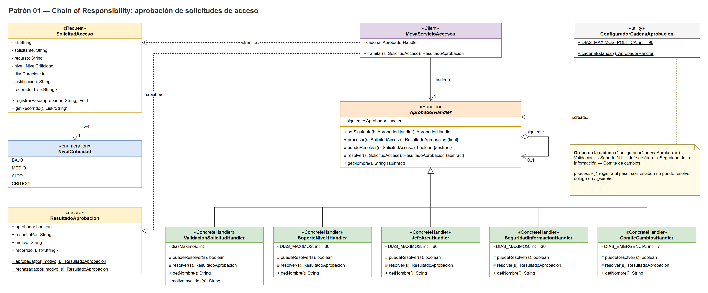
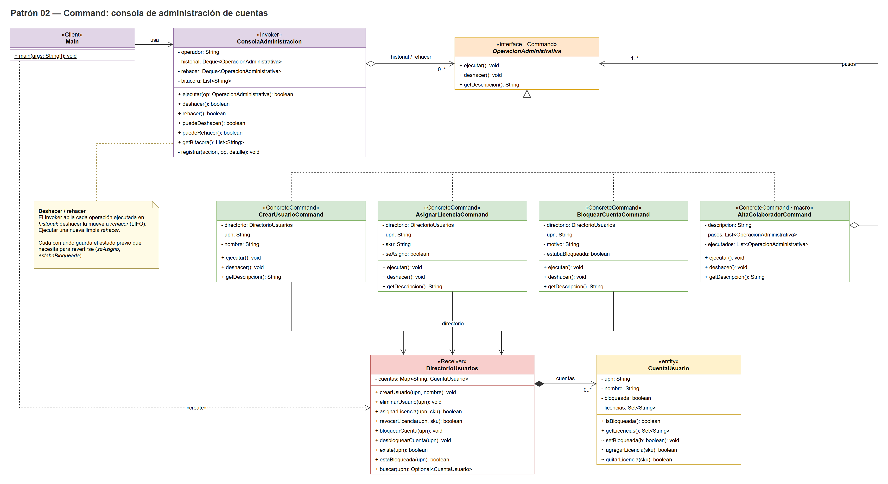

# PDS - Actividad 03: Patrones de comportamiento

**Maestría en Software - Universidad Politécnica Salesiana**

**Asignatura:** Patrones de Diseño de Software

**Docente:** Mauricio Ortiz Ochoa

## Integrantes

- Naranjo Rivadeneira Christian Alberto
- Loor Maridueña Jordy Alexander
- Mesias Vélez Diego Calixto
- Córdova Calle Juan José

## Descripción

Implementación en Java 17 de dos patrones de comportamiento GoF aplicados al
dominio de soporte TI y gestión de identidades:

| Patrón | Escenario | Paquete |
| --- | --- | --- |
| Chain of Responsibility | Aprobación escalonada de solicitudes de acceso | `chain` |
| Command | Operaciones administrativas sobre cuentas con deshacer/rehacer y auditoría | `command` |

## Requisitos

- JDK 17 o superior
- Maven 3.8 o superior

## Ejecutar

```bash
mvn test                 # ejecuta las 19 pruebas JUnit 5
mvn compile exec:java    # ejecuta la demostración de ambos patrones
```

La demostración usa colores ANSI en la consola. Para desactivarlos, define la
variable de entorno `NO_COLOR` antes de ejecutar:

```bash
NO_COLOR=1 mvn compile exec:java          # Linux / macOS
set NO_COLOR=1 && mvn compile exec:java   # Windows (cmd)
```

## Estructura del proyecto

```
src/main/java/
├── Main.java                         Client: demostración de ambos patrones
├── Pantalla.java                     Utilidades de presentación en consola
├── chain/                            Patrón 01 — Chain of Responsibility
│   ├── AprobadorHandler.java
│   ├── ValidacionSolicitudHandler.java
│   ├── SoporteNivel1Handler.java
│   ├── JefeAreaHandler.java
│   ├── SeguridadInformacionHandler.java
│   ├── ComiteCambiosHandler.java
│   ├── ConfiguradorCadenaAprobacion.java
│   ├── MesaServicioAccesos.java
│   ├── SolicitudAcceso.java
│   ├── ResultadoAprobacion.java
│   └── NivelCriticidad.java
└── command/                          Patrón 02 — Command
    ├── OperacionAdministrativa.java
    ├── CrearUsuarioCommand.java
    ├── AsignarLicenciaCommand.java
    ├── BloquearCuentaCommand.java
    ├── AltaColaboradorCommand.java
    ├── ConsolaAdministracion.java
    ├── DirectorioUsuarios.java
    └── CuentaUsuario.java
src/test/java/
├── chain/CadenaAprobacionTest.java
└── command/ConsolaAdministracionTest.java
docs/uml/                             Diagramas de clases (draw.io + PNG)
```

## Patrón 01 — Chain of Responsibility

Una solicitud de acceso recorre la cadena hasta que un eslabón con autoridad la resuelve.
Si ningún eslabón puede resolverla, la cadena la rechaza (denegación por defecto).

```
Validación automática → Soporte N1 → Jefe de área → Seguridad de la Información → Comité de cambios
```

| Eslabón | Aprueba |
| --- | --- |
| Validación automática | Nada: rechaza solicitudes incompletas o de más de 90 días |
| Soporte N1 | Criticidad BAJA, hasta 30 días |
| Jefe de área | Criticidad BAJA o MEDIA, hasta 60 días |
| Seguridad de la Información | Criticidad ALTA, hasta 30 días (con MFA) |
| Comité de cambios | Lo restante, solo accesos de emergencia de hasta 7 días |

| Participante GoF | Clase |
| --- | --- |
| Handler | `AprobadorHandler` |
| ConcreteHandler | `ValidacionSolicitudHandler`, `SoporteNivel1Handler`, `JefeAreaHandler`, `SeguridadInformacionHandler`, `ComiteCambiosHandler` |
| Client | `MesaServicioAccesos` (la cadena la arma `ConfiguradorCadenaAprobacion`) |
| Request | `SolicitudAcceso` |

## Patrón 02 — Command

Cada operación administrativa es un objeto que sabe ejecutarse y deshacerse.
La consola las ejecuta, mantiene el historial de deshacer/rehacer y registra la bitácora de auditoría.
Cada comando guarda el estado previo que necesita para revertirse con exactitud, y el alta de un
colaborador es un macro-comando que revierte los pasos ya ejecutados si uno falla.

| Participante GoF | Clase |
| --- | --- |
| Command | `OperacionAdministrativa` |
| ConcreteCommand | `CrearUsuarioCommand`, `AsignarLicenciaCommand`, `BloquearCuentaCommand`, `AltaColaboradorCommand` (macro) |
| Invoker | `ConsolaAdministracion` |
| Receiver | `DirectorioUsuarios` |
| Client | `Main` |

## Diagramas UML

Diagramas de clases en formato draw.io (ábrelos en https://app.diagrams.net o con la extensión Draw.io de VS Code):

- `docs/uml/chain-of-responsibility.drawio` (imagen: `docs/uml/chain-of-responsibility.png`)
- `docs/uml/command.drawio` (imagen: `docs/uml/command.png`)





## Pruebas

19 pruebas JUnit 5:

- `CadenaAprobacionTest` (10): rechazo en la validación, aprobación en cada nivel, escalamiento por
  duración, rechazo del comité, cadena sin resolutor y un eslabón nuevo integrado sin modificar los existentes.
- `ConsolaAdministracionTest` (9): ejecutar y deshacer, rehacer, invalidación de la pila de rehacer,
  restauración del estado previo, licencia preexistente, macro-comando completo, reversión ante un fallo
  y registro de errores en la bitácora.
